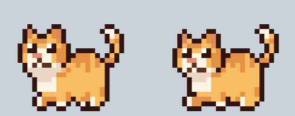
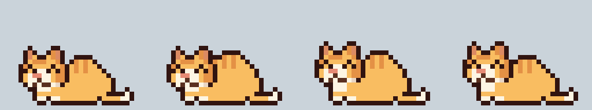
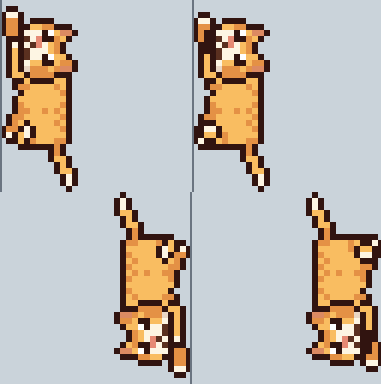

# DontGoCat

여러분의 데스크탑에 고양이를 키워보세요!





## 설치

[Releases](https://github.com/SnippetSH/DontGoCat/releases)에서 운영체제에 맞는 파일을 받으세요.

| 파일 | 대상 |
| --- | --- |
| `DontGoCat-Setup-<버전>.exe` | Windows 설치판 |
| `DontGoCat-<버전>-portable.zip` | Windows 무설치판 |
| `DontGoCat-<버전>.dmg` | macOS 13 이상 (Apple Silicon / Intel) |

### Windows (설치판)

1. `DontGoCat-Setup-<버전>.exe`를 실행합니다.
2. 코드 서명이 없는 앱이라 "Windows의 PC 보호" 창이 뜰 수 있습니다. **추가 정보 → 실행**을 누르세요.
3. 설치가 끝나면 고양이가 바탕화면에 나타납니다. 트레이 아이콘에서 설정하거나 종료할 수 있습니다.

제거는 **설정 → 앱**에서 하면 됩니다.

### Windows (portable.zip)

설치 없이 쓰는 버전입니다. 시작 메뉴 등록이나 제거 프로그램 없이 폴더 하나로 동작합니다.

1. zip을 원하는 폴더에 압축 해제합니다.
2. 폴더 안의 `DontGoCat.exe`를 실행합니다. 처음 실행할 때 SmartScreen 경고가 뜨면 설치판과 같이 **추가 정보 → 실행**을 누르세요.

`settings.txt`는 exe 옆에 있습니다. 더 이상 쓰지 않으면 폴더를 지우면 됩니다.

### macOS (dmg)

1. `DontGoCat-<버전>.dmg`를 열고 `DontGoCat.app`을 **Applications** 폴더로 드래그합니다.
   - dmg나 다운로드 폴더에서 바로 실행하지 말고 꼭 Applications로 옮긴 뒤 실행하세요. 그래야 로그인 시 자동 실행이 제대로 동작합니다.
2. Apple 공증을 받지 않은 앱이라 처음 실행하면 "확인되지 않은 개발자" 경고가 뜨고 열리지 않습니다. 아래 둘 중 하나로 한 번만 허용하면 됩니다.
   - **방법 A:** 경고를 닫고 **시스템 설정 → 개인정보 보호 및 보안**으로 갑니다. 아래쪽에서 DontGoCat 항목의 **그래도 열기**를 누르고 다시 한 번 **열기**를 누릅니다.
   - **방법 B:** 터미널에서 아래 명령을 실행한 뒤 앱을 엽니다.
     ```bash
     xattr -dr com.apple.quarantine /Applications/DontGoCat.app
     ```
3. Dock에는 아이콘이 생기지 않습니다. 메뉴 막대의 고양이 아이콘에서 설정하거나 종료할 수 있습니다.

설정 파일은 `~/Library/Application Support/DontGoCat/settings.txt`에 있습니다.
